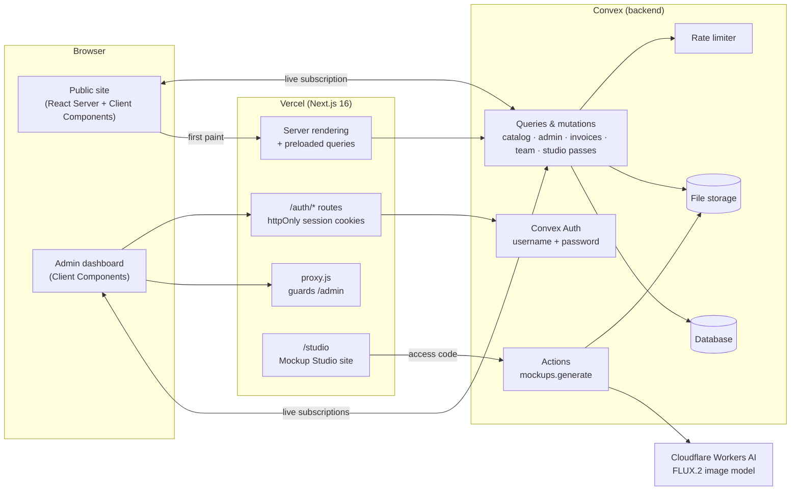
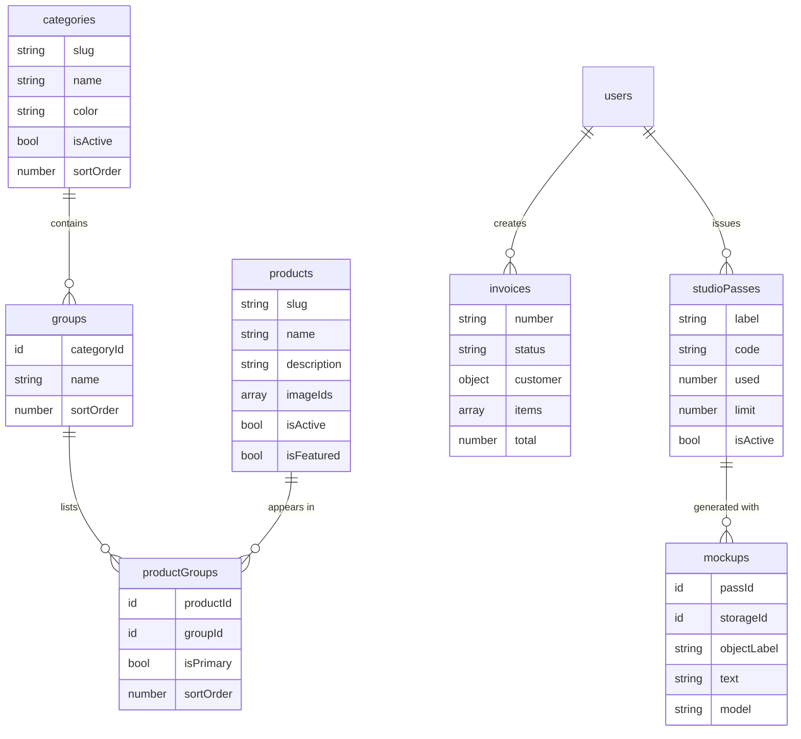

# Dar Al Najah Advertising

The website and internal dashboard for **Dar Al Najah Advertising**, a printing, embroidery, gifting and photo studio business in Dubai.

Customers browse a live product catalogue and talk to the shop on WhatsApp. Staff run the business from a private admin dashboard: products and menus, invoices with PDF and WhatsApp sending, and access passes for the **Mockup Studio**, a separate invite-only site where customers generate AI mockups of their logo on a product.

**Live site:** [daralnajah.vercel.app](https://daralnajah.vercel.app)


---

## Contents

- [Features](#features)
- [Architecture](#architecture)
- [Tech stack](#tech-stack)
- [Data model](#data-model)
- [Security](#security)
- [Performance](#performance)
- [Project structure](#project-structure)
- [Getting started](#getting-started)
- [Scripts](#scripts)
- [Deployment](#deployment)

---

## Features

### Public website

- **Live catalogue**: around 95 products across Printing, Fabric, Gifts and Photo. The mega menu, footer, home page and catalogue all come from the database, so a change in the admin shows up everywhere straight away, with no redeploy.
- **Woven Labels page** (`/woven-labels`): laid out like the other category pages (tabs, search, group chips), with 21 label styles in four groups (label types, folds and finishes, labels by product, manufacturing and supply), each with a photo, description and WhatsApp button. The content lives in the catalogue, so it's edited in the admin. Product photos were generated with Cloudflare Workers AI (`convex/wovenLabels.ts`).
- **Product pages**: photos (or illustrations), name and description. There are no prices online: every product has an "Ask on WhatsApp" button with a pre-filled message.
- **WhatsApp first**: the header, hero, product pages, contact page and a floating button all open a WhatsApp chat with the shop.
- **Photos or illustrations**: every product and category shows uploaded photos when they exist, and falls back to built-in SVG illustrations otherwise.
- **Motion design**: a first-visit intro loader, a scroll-driven text reveal, sticky stacking cards, marquees and parallax. A "lite" mode turns these down on low-end devices, data saver or reduced motion.
- **SEO**: per-page metadata, a generated sitemap and robots file, an Open Graph image, and `LocalBusiness` structured data.
- **Responsive**: designed for phones, tablets and desktop.

### Admin dashboard (`/admin`, staff only)

- **Products**: create and edit products with a description, photo uploads (reorderable), illustrations, featured and live toggles, and placement in one or more menu groups.
- **Menu & categories**: manage categories and groups, reorder everything, and hide a category in one click.
- **Invoices**:
  - catalogue products or custom lines, 5% UAE VAT, discounts and due dates
  - sequential numbering (`INV-2026-0001`) and a draft, issued, paid or void lifecycle
  - **PDF download** in the site's visual style, generated in the browser
  - **WhatsApp sending** to the customer's own number, with a ready message and the PDF
  - list view with clickable rows, quick actions (download, WhatsApp, mark paid with undo), overdue tracking, sortable columns and a per-customer history
- **Studio access**: create a pass for a customer (a 10 character code, 3 generations), copy the code or a direct link, see usage, top up, switch off or delete, and browse every mockup generated.
- **Team**: staff accounts are created by an existing admin. There is no public sign-up.
- **Responsive admin**: a sidebar on desktop, an icon rail on tablets, and a drawer with a fixed action bar on phones.

### Mockup Studio (`/studio`, invite only)

- Part of the main site (same menu, footer and WhatsApp button) but invite only: it asks for an access code before anything else. It can also be served from its own subdomain (for example `studio.daralnajahadv.ae`), whose home page is then the studio.
- Customers enter their access code (or open the link they were sent). Each pass allows **3 generations**, shown as "2 of 3 generations left".
- They drop a product photo (or describe one) plus a logo and/or text, choose the placement, scene and shape, add extra instructions, and get a photorealistic print mockup in a few seconds. Failed attempts don't use up a generation.
- Their mockups stay in a personal gallery for download. When the passes run out, they're invited to message the shop on WhatsApp.

---

## Architecture



### How it fits together

1. **Rendering.** Public pages render on the server, with data preloaded from Convex (`preloadQuery`), so the first paint is complete and good for SEO. In the browser, the same data becomes a **live subscription**: when an admin edits a product, every open page updates in place.
2. **One catalogue query.** `catalog.getCatalog` builds the whole menu tree and the product cards in a single reactive query. The header, footer, home page and catalogue share it through a React context (`CatalogProvider`), so the catalogue is fetched once per visit.
3. **Admin.** Admin pages are client components that talk to Convex directly over a WebSocket. Every admin function on the server starts with `requireAdmin()`, so the UI never enforces security on its own.
4. **Auth.** Convex Auth (username and password) runs behind Next.js route handlers under `/auth/*`, which keep the session in httpOnly cookies. `src/proxy.js` redirects signed-out visitors away from `/admin`.
5. **No online pricing.** Products hold only presentation data (name, description, photos, menu placement). Every enquiry goes to WhatsApp.
6. **Invoices.** Invoices are stored in Convex, which recomputes the totals on every save. PDFs are generated in the browser with `@react-pdf/renderer`, which is loaded only when needed. WhatsApp sending uses `wa.me` links to the customer's number.
7. **Mockup Studio.** The studio browser app sends the access code with each request. A Convex **action** reserves one generation on the pass inside a transaction (refunded if the image fails), applies per pass and daily rate limits, calls Cloudflare Workers AI (FLUX.2), stores the result in Convex file storage and records it against the pass. The API token exists only in Convex environment settings.

---

## Tech stack

| Layer | Technology |
|---|---|
| Languages | **JavaScript** (frontend, React/JSX), **TypeScript** (backend), **CSS** |
| Framework | **Next.js 16** (App Router, Server Components, route handlers, Turbopack) |
| UI | **React 19**, hand-written CSS with design tokens (no UI framework), inline SVG illustrations |
| Fonts | Bricolage Grotesque (display) and Inter Tight (body) via `next/font` |
| Backend & database | **Convex**: reactive queries, mutations, actions, document database and file storage |
| Authentication | **Convex Auth** (`@convex-dev/auth`), username and password, with no public sign-up |
| Rate limiting | `@convex-dev/rate-limiter` |
| PDF generation | `@react-pdf/renderer` (in the browser, loaded on demand) |
| AI image generation | **Cloudflare Workers AI**, FLUX.2 klein (multi-reference image editing) |
| Messaging | WhatsApp click-to-chat links (`wa.me`) |
| Hosting | **Vercel** (website), **Convex Cloud** (backend) |
| Analytics | Vercel Analytics and Speed Insights |
| Code quality | ESLint (official Next.js core-web-vitals rules), TypeScript type checking |
| Source control | Git and GitHub; pushing to `main` deploys automatically |

---

## Data model



- A product can appear in **several menu groups** (`productGroups`). One placement is the **primary** one, which sets its breadcrumb and colour.
- The menu only shows live products in live categories, and empty groups or categories are left out automatically.
- `counters` holds the per-year invoice sequence, and `invoiceSettings` holds the company details printed on invoices.

The full schema, with validators, is in [`web/convex/schema.ts`](web/convex/schema.ts).

---

## Security

- **No public sign-up.** Accounts can only be created by an existing admin (Team page) or from the CLI. Deleting an account revokes access immediately, even for open sessions.
- **Checked on the server every time.** Every admin query, mutation and action calls `requireAdmin()`. Inputs are validated with Convex validators plus length and range checks, and totals and prices are recomputed on the server.
- **Sign-in protection.** Convex Auth rate-limits password attempts, and error messages never reveal which usernames exist.
- **Mockup Studio sign-in**: access codes are 10 random characters (about 10^15 combinations) and can only be checked through the website server (`/api/studio/session`), which adds the visitor IP and a server-only key. Each IP gets 8 attempts (refilling one every 2 minutes) under a site-wide ceiling, and requests from other websites are refused. A correct code returns a 256-bit session key; only its SHA-256 hash is stored, sessions expire after 30 days, and switching a pass off signs out every device. Usage is counted in a database transaction, so the 3-generation limit can't be bypassed.
- **No SQL injection surface**: Convex has no query language to inject into. Every query is built with typed index lookups, and every function argument is checked by a schema validator before the code runs. React escapes all user content, and the only raw HTML is two fixed scripts.
- **Content Security Policy**: strict on the public site, with a separate policy for admin pages (for the PDF engine). Plus `frame-ancestors 'none'`, `nosniff` and a strict referrer policy.
- **Uploads**: only images are accepted, with a size cap, and files that are replaced or removed are deleted from storage.
- **Secrets** stay in Vercel or Convex environment variables and are never committed. `.env*` files are git-ignored.

---

## Performance

- Server-rendered first paint with preloaded data, followed by live updates with no refetching.
- Backend queries load related data **in parallel** (`Promise.all`). The catalogue tree is built in memory from a few batched reads.
- `next/image` for uploaded photos. Heavy libraries (the PDF engine) are loaded only on demand.
- Animations run on CSS and `requestAnimationFrame`. Looping effects pause while off-screen, below-the-fold sections use `content-visibility`, and a "lite" mode reduces effects on low-end devices.

---

## Project structure

```
.
├── design/brand/              Original logo artwork
└── web/                       The application (Vercel root directory)
    ├── convex/                Backend (TypeScript)
    │   ├── schema.ts          Database schema and validators
    │   ├── catalog.ts         Public catalogue queries
    │   ├── admin.ts           Products and menu (admin only)
    │   ├── invoices.ts        Invoicing
    │   ├── mockups.ts         Mockup Studio: passes, generation, gallery
    │   ├── team.ts, auth.ts   Staff accounts and sign-in
    │   └── lib/               Shared server helpers (admin check, validation, copy style)
    ├── src/
    │   ├── app/(site)/        Public pages: home, catalogue, product, contact
    │   ├── app/admin/         Admin dashboard pages
    │   ├── app/(site)/studio/ Mockup Studio (invite only)
    │   ├── app/auth/          Sign-in session routes
    │   ├── components/        Site components (Header, Hero, Mock illustrations…)
    │   ├── components/admin/  Admin components (editors, invoice PDF, shell)
    │   ├── components/studio/ Mockup Studio UI
    │   ├── lib/               Shared client helpers (errors, uploads, WhatsApp…)
    │   ├── data/site.js       Business details (phone, hours, address)
    │   └── proxy.js           Guards /admin routes
    ├── public/                Static assets, logo files, fonts
    ├── next.config.mjs        Security headers and image settings
    └── eslint.config.mjs      Lint rules
```

---

## Getting started

**Requirements:** Node.js 22 or newer, and a free [Convex](https://convex.dev) account.

```bash
cd web
npm install
cp .env.example .env.local
```

```bash
npx convex dev   # terminal 1: creates/syncs your dev backend and fills in .env.local
```

```bash
npm run dev      # terminal 2: http://localhost:3000
```

Then, once only:

```bash
npx convex run seed:run                                              # starter catalogue
npx convex run team:bootstrapAdmin '{"username":"owner","password":"choose-a-strong-one"}'
```

Sign in at `http://localhost:3000/admin`.

**Optional settings in the Convex environment** (Convex dashboard, then Settings, then Environment variables):

| Variable | Purpose |
|---|---|
| `ADMIN_USERNAMES` | Comma-separated usernames that are always admins |
| `CLOUDFLARE_ACCOUNT_ID`, `CLOUDFLARE_API_TOKEN` | Enable the Mockup Studio (Workers AI token) |
| `STUDIO_SERVER_KEY` | Shared secret for Mockup Studio sign-in (same value in Vercel) |

---

## Scripts

Run these from `web/`:

| Command | What it does |
|---|---|
| `npm run dev` | Start the development server |
| `npm run build` | Production build |
| `npm run lint` | ESLint |
| `npm run typecheck` | Type-check the Convex backend |
| `npm run check` | Lint and type-check together |

---

## Deployment

- **Website:** pushing to `main` deploys on **Vercel** automatically (Root Directory `web`). Set `NEXT_PUBLIC_CONVEX_URL`, `NEXT_PUBLIC_SITE_URL` and `STUDIO_SERVER_KEY` in the Vercel project. To give the Mockup Studio its own address, add a `studio.` subdomain to the Vercel project.
- **Backend:** changes in `web/convex` are deployed with `npx convex deploy` from `web/`.

---

## Credits

Designed & built by **[PEERBROS](https://www.peerbros.com) x [Themeszoo](https://www.themeszoo.com)**.
