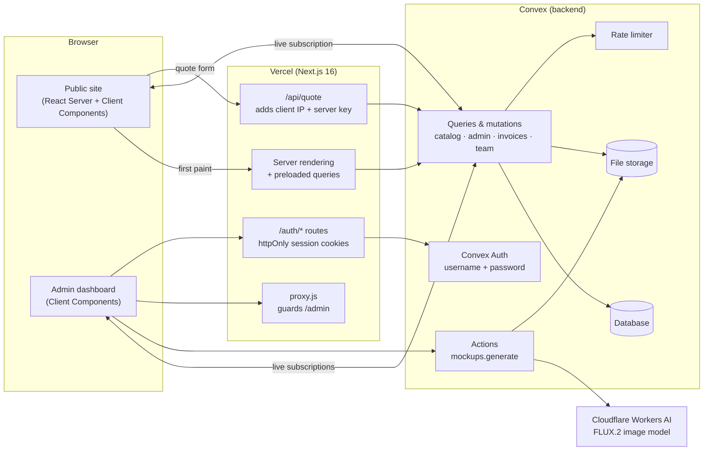
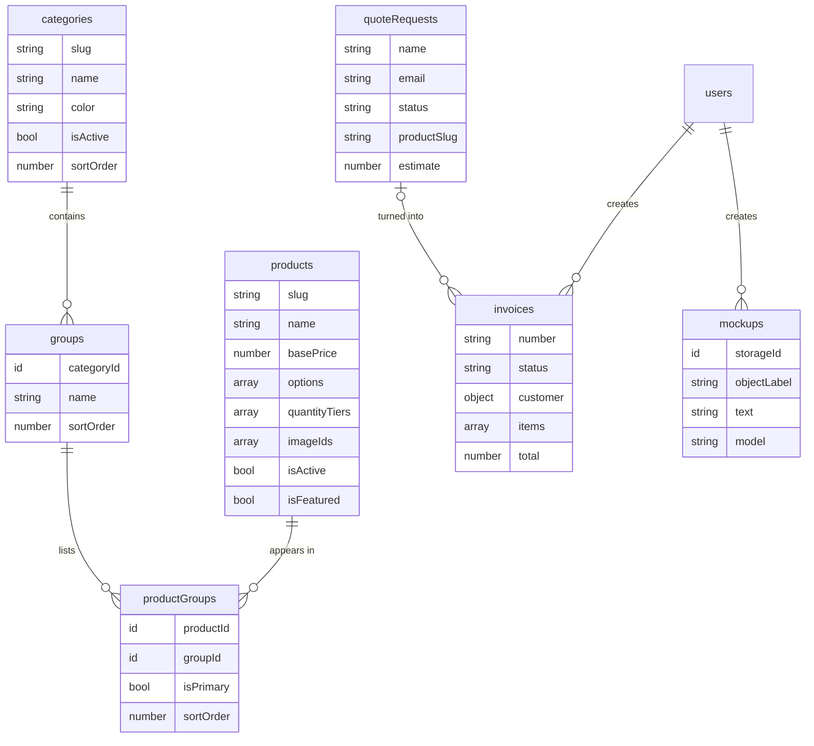

# Dar Al Najah Advertising

The website and internal dashboard for **Dar Al Najah Advertising**, a printing, embroidery, gifting and photo studio business in Dubai.

Customers browse a live product catalogue, configure a product, see an estimated price and request a quote. Staff run the business from a private admin dashboard: products and menus, quote requests, invoices with PDF and WhatsApp sending, and an AI mockup studio for showing customers their logo on a product.

**Live site:** [daralnajah.vercel.app](https://daralnajah.vercel.app)


---

## Contents

- [Features](#features)
- [Architecture](#architecture)
- [Tech stack](#tech-stack)
- [Data model](#data-model)
- [Security](#security)
- [Performance](#performance)
- [Project structure](#project-structure)
- [Getting started](#getting-started)
- [Scripts](#scripts)
- [Deployment](#deployment)

---

## Features

### Public website

- **Live catalogue**: around 95 products across Printing, Fabric, Gifts and Photo. The mega menu, footer, home page and catalogue all come from the database, so a change in the admin shows up everywhere straight away, with no redeploy.
- **Product configurator**: options (paper, finish and so on), quantity tiers and a live price estimate, then one click to request a quote or message on WhatsApp.
- **Quote requests**: a contact form that arrives pre-filled from the product page, protected against spam (see [Security](#security)).
- **Photos or illustrations**: every product and category shows uploaded photos when they exist, and falls back to built-in SVG illustrations otherwise.
- **Motion design**: a first-visit intro loader, a scroll-driven text reveal, sticky stacking cards, marquees and parallax. A "lite" mode turns these down on low-end devices, data saver or reduced motion.
- **SEO**: per-page metadata, a generated sitemap and robots file, an Open Graph image, and `LocalBusiness` structured data.
- **Responsive**: designed for phones, tablets and desktop.

### Admin dashboard (`/admin`, staff only)

- **Products**: create and edit products with options, quantity pricing, photo uploads (drag to reorder), illustrations, featured and live toggles, and placement in one or more menu groups.
- **Menu & categories**: manage categories and groups, reorder everything, and hide a category in one click.
- **Quote inbox**: requests with status tracking (new, quoted, won, lost), email and WhatsApp shortcuts, and "Create invoice" from a quote.
- **Invoices**:
  - catalogue products or custom lines, 5% UAE VAT, discounts and due dates
  - sequential numbering (`INV-2026-0001`) and a draft, issued, paid or void lifecycle
  - **PDF download** in the site's visual style, generated in the browser
  - **WhatsApp sending** to the customer's own number, with a ready message and the PDF
  - list view with clickable rows, quick actions (download, WhatsApp, mark paid with undo), overdue tracking, sortable columns and a per-customer history
- **Mockup studio**: drop a product photo (or describe one), a logo and/or text, choose the placement, scene and shape, and add extra instructions. It then generates a photorealistic print mockup with AI. Results are saved to a shared team gallery.
- **Team**: staff accounts are created by an existing admin. There is no public sign-up.
- **Responsive admin**: a sidebar on desktop, an icon rail on tablets, and a drawer with a fixed action bar on phones.

---

## Architecture



### How it fits together

1. **Rendering.** Public pages render on the server, with data preloaded from Convex (`preloadQuery`), so the first paint is complete and good for SEO. In the browser, the same data becomes a **live subscription**: when an admin edits a product, every open page updates in place.
2. **One catalogue query.** `catalog.getCatalog` builds the whole menu tree and the product cards in a single reactive query. The header, footer, home page and catalogue share it through a React context (`CatalogProvider`), so the catalogue is fetched once per visit.
3. **Admin.** Admin pages are client components that talk to Convex directly over a WebSocket. Every admin function on the server starts with `requireAdmin()`, so the UI never enforces security on its own.
4. **Auth.** Convex Auth (username and password) runs behind Next.js route handlers under `/auth/*`, which keep the session in httpOnly cookies. `src/proxy.js` redirects signed-out visitors away from `/admin`.
5. **Quote form.** The form posts to a Next.js route that adds the visitor's IP (set by Vercel, so it can't be spoofed) and a server-only shared key before calling Convex. Convex then rate-limits per IP, per email and site-wide.
6. **Invoices.** Invoices are stored in Convex, which recomputes the totals on every save. PDFs are generated in the browser with `@react-pdf/renderer`, which is loaded only when needed. WhatsApp sending uses `wa.me` links to the customer's number.
7. **AI mockups.** The browser shrinks the images, then a Convex **action** checks admin rights and rate limits, calls Cloudflare Workers AI (FLUX.2), stores the result in Convex file storage and records it in the gallery. The API token exists only in Convex environment settings.

---

## Tech stack

| Layer | Technology |
|---|---|
| Languages | **JavaScript** (frontend, React/JSX), **TypeScript** (backend), **CSS** |
| Framework | **Next.js 16** (App Router, Server Components, route handlers, Turbopack) |
| UI | **React 19**, hand-written CSS with design tokens (no UI framework), inline SVG illustrations |
| Fonts | Bricolage Grotesque (display) and Inter Tight (body) via `next/font` |
| Backend & database | **Convex**: reactive queries, mutations, actions, document database and file storage |
| Authentication | **Convex Auth** (`@convex-dev/auth`), username and password, with no public sign-up |
| Rate limiting | `@convex-dev/rate-limiter` |
| PDF generation | `@react-pdf/renderer` (in the browser, loaded on demand) |
| AI image generation | **Cloudflare Workers AI**, FLUX.2 klein (multi-reference image editing) |
| Messaging | WhatsApp click-to-chat links (`wa.me`) |
| Hosting | **Vercel** (website), **Convex Cloud** (backend) |
| Analytics | Vercel Analytics and Speed Insights |
| Code quality | ESLint (official Next.js core-web-vitals rules), TypeScript type checking |
| Source control | Git and GitHub; pushing to `main` deploys automatically |

---

## Data model



- A product can appear in **several menu groups** (`productGroups`). One placement is the **primary** one, which sets its breadcrumb and colour.
- The menu only shows live products in live categories, and empty groups or categories are left out automatically.
- `counters` holds the per-year invoice sequence, and `invoiceSettings` holds the company details printed on invoices.

The full schema, with validators, is in [`web/convex/schema.ts`](web/convex/schema.ts).

---

## Security

- **No public sign-up.** Accounts can only be created by an existing admin (Team page) or from the CLI. Deleting an account revokes access immediately, even for open sessions.
- **Checked on the server every time.** Every admin query, mutation and action calls `requireAdmin()`. Inputs are validated with Convex validators plus length and range checks, and totals and prices are recomputed on the server.
- **Sign-in protection.** Convex Auth rate-limits password attempts, and error messages never reveal which usernames exist.
- **Spam protection** on the quote form: a honeypot field, a server-only shared key, and rate limits per IP, per email and site-wide.
- **Content Security Policy**: strict on the public site, with a separate policy for admin pages (for the PDF engine). Plus `frame-ancestors 'none'`, `nosniff` and a strict referrer policy.
- **Uploads**: only images are accepted, with a size cap, and files that are replaced or removed are deleted from storage.
- **Secrets** stay in Vercel or Convex environment variables and are never committed. `.env*` files are git-ignored.

---

## Performance

- Server-rendered first paint with preloaded data, followed by live updates with no refetching.
- Backend queries load related data **in parallel** (`Promise.all`). The catalogue tree is built in memory from a few batched reads.
- `next/image` for uploaded photos. Heavy libraries (the PDF engine) are loaded only on demand.
- Animations run on CSS and `requestAnimationFrame`. Looping effects pause while off-screen, below-the-fold sections use `content-visibility`, and a "lite" mode reduces effects on low-end devices.

---

## Project structure

```
.
├── design/brand/              Original logo artwork
└── web/                       The application (Vercel root directory)
    ├── convex/                Backend (TypeScript)
    │   ├── schema.ts          Database schema and validators
    │   ├── catalog.ts         Public catalogue queries
    │   ├── admin.ts           Products, menu, quotes (admin only)
    │   ├── invoices.ts        Invoicing
    │   ├── mockups.ts         AI mockup studio
    │   ├── quotes.ts          Quote form submission and rate limits
    │   ├── team.ts, auth.ts   Staff accounts and sign-in
    │   └── lib/               Shared server helpers (admin check, validation, copy style)
    ├── src/
    │   ├── app/(site)/        Public pages: home, catalogue, product, contact
    │   ├── app/admin/         Admin dashboard pages
    │   ├── app/api/quote/     Quote form endpoint
    │   ├── app/auth/          Sign-in session routes
    │   ├── components/        Site components (Header, Hero, Mock illustrations…)
    │   ├── components/admin/  Admin components (editors, invoice PDF, shell)
    │   ├── lib/               Shared client helpers (errors, uploads, WhatsApp…)
    │   ├── data/site.js       Business details (phone, hours, address)
    │   └── proxy.js           Guards /admin routes
    ├── public/                Static assets, logo files, fonts
    ├── next.config.mjs        Security headers and image settings
    └── eslint.config.mjs      Lint rules
```

---

## Getting started

**Requirements:** Node.js 22 or newer, and a free [Convex](https://convex.dev) account.

```bash
cd web
npm install
cp .env.example .env.local
```

```bash
npx convex dev   # terminal 1: creates/syncs your dev backend and fills in .env.local
```

```bash
npm run dev      # terminal 2: http://localhost:3000
```

Then, once only:

```bash
npx convex run seed:run                                              # starter catalogue
npx convex run team:bootstrapAdmin '{"username":"owner","password":"choose-a-strong-one"}'
```

Sign in at `http://localhost:3000/admin`.

**Optional settings in the Convex environment** (Convex dashboard, then Settings, then Environment variables):

| Variable | Purpose |
|---|---|
| `QUOTE_SERVER_KEY` | Shared secret for the quote form (same value in Vercel) |
| `ADMIN_USERNAMES` | Comma-separated usernames that are always admins |
| `CLOUDFLARE_ACCOUNT_ID`, `CLOUDFLARE_API_TOKEN` | Enable the Mockup studio (Workers AI token) |

---

## Scripts

Run these from `web/`:

| Command | What it does |
|---|---|
| `npm run dev` | Start the development server |
| `npm run build` | Production build |
| `npm run lint` | ESLint |
| `npm run typecheck` | Type-check the Convex backend |
| `npm run check` | Lint and type-check together |

---

## Deployment

- **Website:** pushing to `main` deploys on **Vercel** automatically (Root Directory `web`). Set `NEXT_PUBLIC_CONVEX_URL`, `NEXT_PUBLIC_SITE_URL` and `QUOTE_SERVER_KEY` in the Vercel project.
- **Backend:** changes in `web/convex` are deployed with `npx convex deploy` from `web/`.
